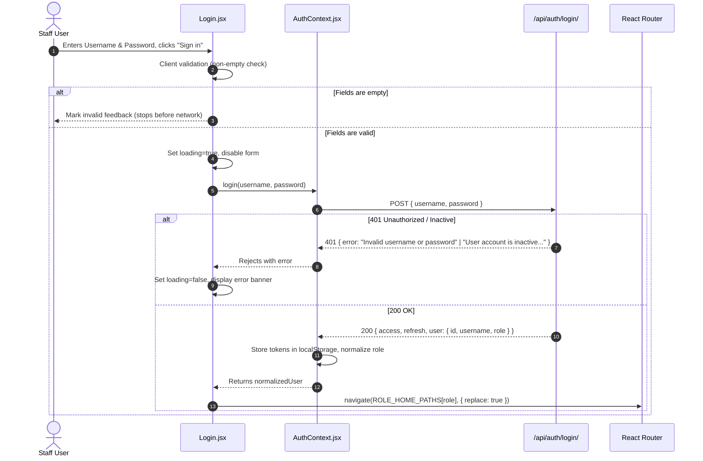

# Specification: CMS Login Portal Redesign

## 1. Overview & Context
This specification details the overhaul of the Clinic Management System (CMS) login portal. The visual design is derived from the Stitch prototype (`stitch_clinic_management_login_portal.zip`), adapted to fit the repository's technology stack: **React 19 + Vite + Bootstrap 5.3 + Django REST Framework with SimpleJWT**.

All decisions herein were agreed upon during the `/grill-with-docs` session and recorded in [ADR 001](file:///e:/Faith%20Infotech/Camp%204[frontend]/ClinicManagementSystem/docs/adr/2026-11-13-login-portal-redesign-and-auth-flow.md).

---

## 2. Goals & Non-Goals

### Goals
- **Split-Screen Layout:** Responsive two-column desktop layout (left: login form, right: pale mint branding card). Responsive fallback to single-column stacked on smaller viewports.
- **Visual Parity:** Faithful adaptation of Stitch styling: rounded pill inputs (`rounded-pill`), icon prefixes, show/hide password toggle, full-width `#111827` black pill submit button, subtle clinic brand mark (`AOC Clinic` / `Preclinic CMS`).
- **Server-Authoritative RBAC Routing:** Immediate redirection to the correct role dashboard (`ROLE_HOME_PATHS`) based solely on the server-returned JWT claims.
- **Robust Error & In-Flight Feedback:** Clean client-side validation preventing 400s; inline red alert box displaying server error messages; disabled form state and animated spinner during submission.
- **Offline Self-Contained Assets:** Zero external CDN dependencies; illustration bundled locally at `frontend/public/assets/login-illustration.png`.
- **Pure Bootstrap 5 + Scoped CSS:** Zero Tailwind CSS; all styling isolated in `src/pages/Login.css` alongside Bootstrap 5 classes.

### Non-Goals (Out of Scope)
- **Role Selector Pill:** Removed. Backend does not accept a role parameter; role is derived strictly by the backend.
- **Patient Authentication:** Out of scope. `Patient` entity is unauthenticated in the current architecture.
- **Self-Service Password Reset:** Out of scope. "Forgot password?" provides an inline prompt to contact the Clinic Administrator.
- **Social Login / Registration / "Remember Me":** Out of scope. Tokens persist in `localStorage` as currently implemented.

---

## 3. UI Component Architecture

### Left Panel (Login Form)
- **Brand Header:**
  - Rounded green squircle icon (`#3FA66B`) with white medical plus icon.
  - Clinic title: **Preclinic CMS** with status badge.
- **Headline:**
  - Display heading: *"Welcome back!"*
  - Sub-text: *"Sign in to continue to your dashboard."*
- **Error Alert Banner:**
  - Collapsible rose-tinted banner (`bg-danger-subtle border-danger-subtle text-danger`) with warning triangle icon.
- **Form Controls:**
  - **Username Field:** Rounded pill input with `bi-person` icon. Strictly labeled *"Username"*, placeholder *"Enter your username"*.
  - **Password Field:** Rounded pill input with `bi-lock` icon and toggleable `bi-eye`/`bi-eye-slash` visibility button.
  - **Helper Row:** "Forgot password?" link on the right. Clicking toggles an inline helper line: *"Please contact your Clinic Administrator to reset your password."*
  - **Submit Button:** Full-width black pill button (`#111827`, hover: `#000000`). Displays *"Sign in"* or spinner with *"Verifying..."*.
- **Admin Notice:**
  - Divider with *"or"*, followed by note: *"Staff accounts are created and managed by the clinic admin."*
- **Footer:**
  - Shield icon with *"Secure, role-based access"* and static privacy link.

### Right Panel (Brand Hero Card)
- **Background & Container:** Large rounded container (`#EAF4EC`, border `#D1E7DD`).
- **Illustration:** Scaled doctor-patient graphic loaded from `/assets/login-illustration.png`.
- **Copy:**
  - Headline: *"Care, records and pharmacy in one place"*
  - Sub-headline: *"Appointments, consultations, prescriptions and stock, managed together."*

---

## 4. Authentication & Data Flow

---

## 5. Verification & Acceptance Criteria
1. **Visual Parity:** Desktop renders split-screen layout with left form and right mint panel; tablets and mobile stack smoothly.
2. **Form Validation:** Submitting empty fields triggers HTML5/Bootstrap validation without invoking `authApi.login`.
3. **Loading State:** During inflight login, inputs, forgot-password trigger, and the submit button are disabled; button text switches to "Verifying..." with spinner.
4. **Error Handling:** 401 errors from backend (e.g. wrong password or inactive user) render immediately in the alert banner with exact server message.
5. **Role Routing:** Logging in as Admin, Doctor, Receptionist, Pharmacist, or Lab Tech routes to `/admin`, `/doctor`, `/receptionist`, `/pharmacist`, and `/lab` respectively.
6. **No External Requests:** No fonts or images fetched from external CDNs during login rendering.
